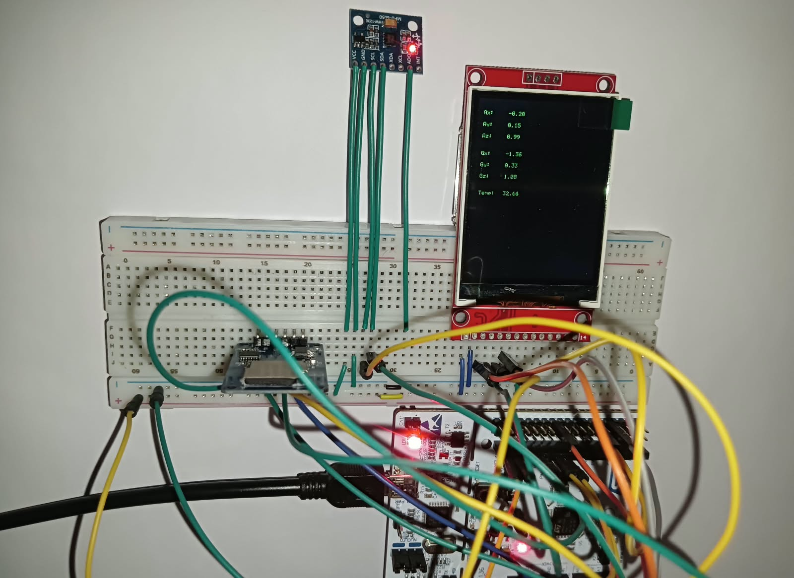
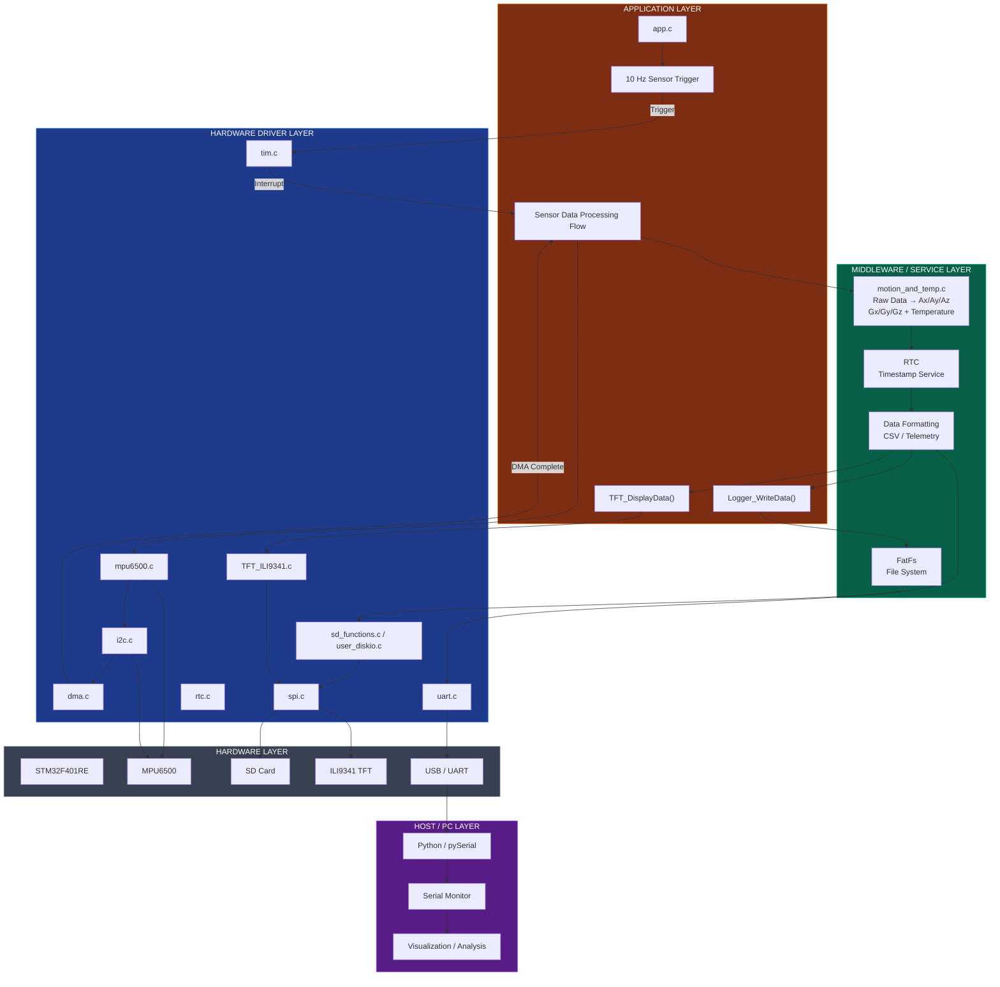
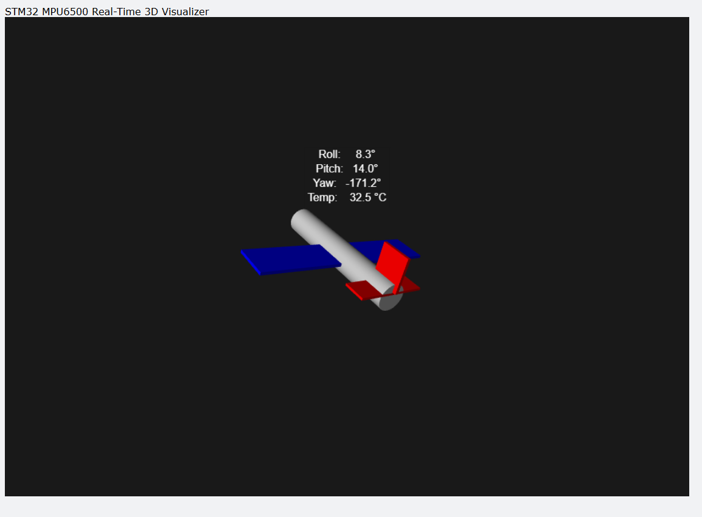
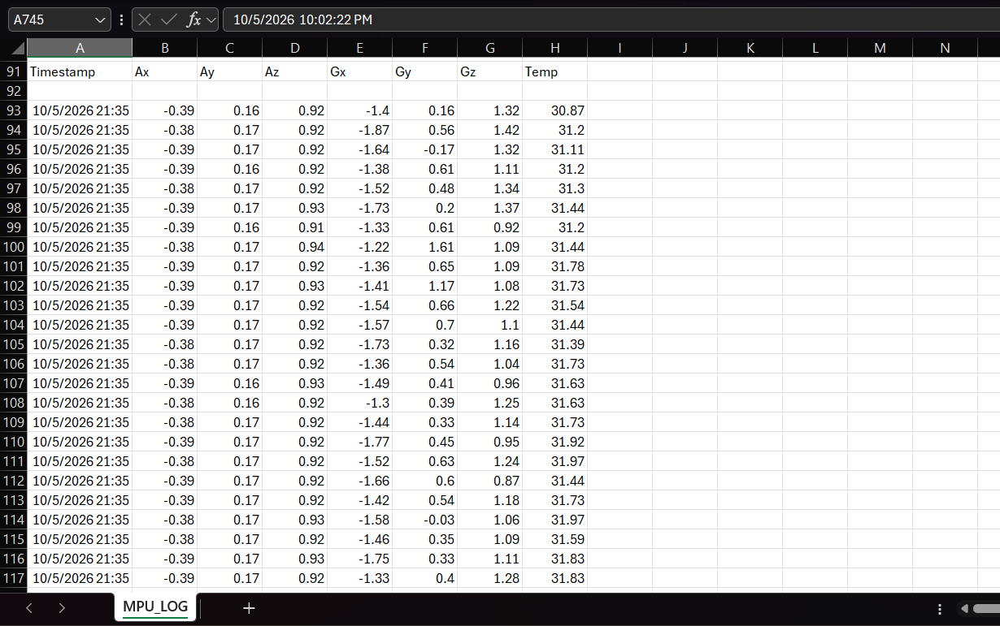

# STM32F401RE MPU6500 MotionSense

A real-time embedded motion monitoring and data logging system built using **STM32F401RE**, **MPU6500**, **ILI9341 TFT**, and an **SD card**.

The system reads acceleration, gyroscope, and temperature data from the MPU6500 using **I2C and DMA**, processes the data on the STM32, displays it on the TFT, logs it to an SD card, and sends telemetry to a PC for visualization over UART.



## 1. Project Overview

This project is designed as an embedded data-acquisition system.

The STM32 periodically reads the MPU6500 sensor and generates:

- Acceleration: `Ax, Ay, Az`
- Gyroscope: `Gx, Gy, Gz`
- Temperature
- RTC timestamp

The processed data is simultaneously used for:

- Live display on the **ILI9341 TFT**
- CSV data logging on the **SD card**
- UART transmission to a PC
- Real-time visualization using Python

The stored data can also be used for **post-flight analysis**, such as analyzing acceleration, rotation, vibration, and orientation data after a rocket or other flight-test experiment.

## 2. System Architecture



## 3. Implementation & Output

The STM32 uses a timer to periodically start an MPU6500 DMA transfer. After the DMA transfer is complete, the sensor data is processed and timestamped.

A simplified version of the application flow is:

```c
if (trigger_mpu_read_timer)
{
    trigger_mpu_read_timer = 0;
    MPU6500_Start_Read_DMA();
}

if (mpu_data_ready)
{
    mpu_data_ready = 0;

    process_mpu6500_motion_and_temp();

    RTC_GetTime(&year, &month, &day,
                &hour, &minute, &second);

    Logger_WriteData(year, month, day,
                     hour, minute, second,
                     Ax, Ay, Az,
                     Gx, Gy, Gz,
                     Tempr);

    TFT_DisplayData();
}
```

The MPU6500 driver reads the sensor registers starting from `0x3B` and receives the 14-byte sensor block using DMA.

Example logged CSV data:

```text
Timestamp,Ax,Ay,Az,Gx,Gy,Gz,Temp
2026-10-05 21:36:44,-0.32,0.16,0.95,-1.45,0.64,1.06,32.26
```

### Real-Time 3D Visualization



The Python/pySerial application receives the STM32 telemetry and displays the calculated orientation in real time.

### SD Card Data Logging



The sensor readings are stored on the SD card as timestamped CSV data, allowing the recorded data to be analyzed later using Python, Excel, MATLAB, or other analysis tools.

## 4. Hardware & Applications

### Hardware

- STM32F401RE Nucleo
- MPU6500 6-axis IMU
- ILI9341 2.4" TFT
- SD card module

### Technologies

- CMSIS/Bare-Metal C
- STM32F4XX
- I2C
- DMA
- SPI
- UART
- RTC
- FatFs
- Python
- pySerial

### Possible Applications

- Embedded motion monitoring
- Flight-data acquisition
- UAV and robotics experiments
- Orientation and vibration monitoring
- Rocket flight-data recording
- **Post-rocket-flight data analysis**
- Offline sensor-data analysis

---

**made by Amiruddin**